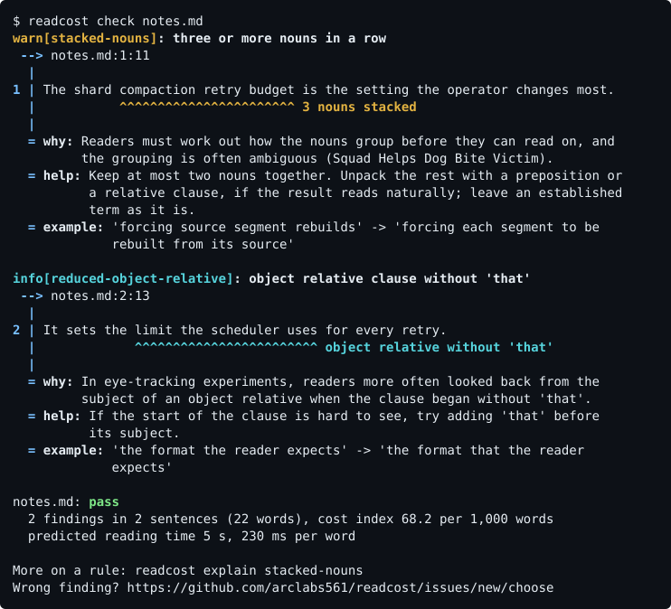

# readcost

readcost marks constructions in English technical prose that recent
language models use more often than people do, such as a run of three or more
nouns or a subject far from its verb. For each one it quotes the line, marks
the words, and suggests a rewrite. The constructions come from "Why is
AI-generated language so hard to understand?"
([arXiv 2610.29162](https://arxiv.org/abs/2610.29162)), which finds that
models use them more often than paraphrases of the same content do; against
human corpora, the difference is consistent only for inanimate subjects.
Studies of constructed sentences tie each construction to harder reading. In
real prose that has not been shown: on the reading-time and rating datasets
tested so far, sentences with findings were not rated harder, and at most
slightly slower to read, once length and word frequency were held
([Limits](#limits)). Treat a finding as a place to reread, not as a measured
cost.

For example, this sentence from a README:

```text
For store restart measurement, the example prints first snapshot-query cost
with persisted WAND sidecars present versus after deleting those sidecars and
forcing source-segment rebuilds.
```

```text
warn[stacked-nouns]: three or more nouns in a row
 --> notes.md:1:5
  |
1 | For store restart measurement, the example prints first snapshot-query cost
  |     ^^^^^^^^^^^^^^^^^^^^^^^^^ 3 nouns stacked
  |
  = why: Readers must work out how the nouns group before they can read on, and
         the grouping is often ambiguous (Squad Helps Dog Bite Victim).
  = help: Keep at most two nouns together. Unpack the rest with a preposition or
          a relative clause, if the result reads naturally; leave an established
          term as it is.
  = example: 'forcing source segment rebuilds' -> 'forcing each segment to be
             rebuilt from its source'

warn[hyphen-compound]: ad hoc hyphenated noun compound
 --> notes.md:3:9
  |
3 | forcing source-segment rebuilds.
  |         ^^^^^^^^^^^^^^^^^^^^^^^ coined compound modifier
  |
  = why: Coined compounds such as storage-shrink or region-index are rare word
         pairs, which the paper links to slower reading.
  = help: Write the relationship out.
  = example: 'the storage-shrink use case' -> 'the main use: storing ID sets in
             less space'

notes.md: advise
  2 findings in 1 sentence (26 words), cost index 76.9 per 1,000 words
  predicted reading time 7 s, 301 ms per word

More on a rule: readcost explain stacked-nouns
Wrong finding? https://github.com/arclabs561/readcost/issues/new/choose
```

The rewrite that README adopted keeps every fact and passes:

```text
To measure a store restart, the example reopens a checkpointed store and
prints the duration of its first snapshot query. It does this twice: once
with the persisted WAND sidecars present, and once after deleting those
sidecars, which forces each segment to be rebuilt from its source vectors.
```

It is also longer, so readcost predicts less time per word but more in total;
[docs/reading-time.md](https://github.com/arclabs561/readcost/blob/main/docs/reading-time.md)
shows the comparison and how to weigh the two.

## Install

```sh
uvx readcost check README.md    # run without installing
uv tool install readcost        # or install it; pip install readcost also works
```

This README describes the main branch, which can be ahead of the release on
PyPI; run main with
`uvx --from git+https://github.com/arclabs561/readcost readcost`. readcost is
experimental: before 1.0, output and configuration can change between minor
versions.

It needs Python 3.11 or later; its main dependencies are spaCy and
markdown-it-py. On first use readcost downloads spaCy's English
model (about 13 MB, checksum verified) into `~/.cache/readcost`, so it also
works under `uvx`. `readcost setup` does the download ahead of time, and
`READCOST_NO_DOWNLOAD=1` forbids it, for example on an offline machine with
the model installed as a package.

## Use

readcost reads documentation and commit messages. It also reads doc comments
in source files, the Markdown cells of Jupyter
notebooks, and a model's answers on stdin or in a transcript
([formats](https://github.com/arclabs561/readcost/blob/main/docs/configuration.md#formats)).

```sh
readcost check README.md docs/
readcost check ~/src                         # a whole tree; git-aware, parallel
readcost check --lines 40-80 README.md       # only sentences touching these lines
some-model-cli "explain X" | readcost check -    # model output on stdin
readcost check --format transcript --last session.jsonl
readcost check src/lib.rs                    # doc comments
readcost explain stacked-nouns               # why a rule fires, and how to fix it
readcost compare HEAD:README.md README.md    # findings and reading time, before and after
```



`-o concise`, `json`, `sarif`, `github`, `agent` and `pr-comment` change the
output. The exit status is 1 when a file reaches the `--fail-on` verdict
(default `block`), 2 on an error, and 0 otherwise.
[docs/configuration.md](https://github.com/arclabs561/readcost/blob/main/docs/configuration.md#output)
describes each format and the Python API (`readcost.check_text`).

Other commands:

- `readcost style` compares a document set with a built-in reference, such as
  the Go docs, rule by rule; `readcost corpus` measures repeated templates
  across many texts
  ([docs/style.md](https://github.com/arclabs561/readcost/blob/main/docs/style.md)).
- `readcost baseline` records the findings in existing docs so that only new
  ones count
  ([docs/configuration.md](https://github.com/arclabs561/readcost/blob/main/docs/configuration.md#adopting-readcost-in-an-existing-repo)).
- `readcost profile build` makes a reference profile from writing you prefer
  ([docs/rules.md](https://github.com/arclabs561/readcost/blob/main/docs/rules.md#verdicts)).
- `readcost label` exports findings for people to judge and reports their
  agreement
  ([docs/labels.md](https://github.com/arclabs561/readcost/blob/main/docs/labels.md)).

## What it flags

| Rule | Flags |
| --- | --- |
| stacked-nouns | [three or more nouns in a row](https://github.com/arclabs561/readcost/blob/main/docs/rules.md#stacked-nouns) |
| long-dependency | [a subject far from its verb, or a verb far from its object](https://github.com/arclabs561/readcost/blob/main/docs/rules.md#long-dependency) |
| reduced-object-relative | [an object relative clause without "that"](https://github.com/arclabs561/readcost/blob/main/docs/rules.md#reduced-object-relative) |
| hyphen-compound | [an ad hoc hyphenated noun compound](https://github.com/arclabs561/readcost/blob/main/docs/rules.md#hyphen-compound) |
| inline-list | [four or more items listed in one sentence](https://github.com/arclabs561/readcost/blob/main/docs/rules.md#inline-list) |
| inanimate-subject (opt-in) | [a thing doing a person's action](https://github.com/arclabs561/readcost/blob/main/docs/rules.md#inanimate-subject) |
| participial-clause (opt-in) | [a clause hung on an -ing verb after a comma](https://github.com/arclabs561/readcost/blob/main/docs/rules.md#participial-clause) |
| nominalization (opt-in) | [an action written as a noun](https://github.com/arclabs561/readcost/blob/main/docs/rules.md#nominalization) |
| center-embedding (opt-in) | [a clause nested inside a nested clause](https://github.com/arclabs561/readcost/blob/main/docs/rules.md#center-embedding) |
| undefined-acronym (opt-in) | [an acronym used before it is spelled out](https://github.com/arclabs561/readcost/blob/main/docs/rules.md#undefined-acronym) |

[docs/rules.md](https://github.com/arclabs561/readcost/blob/main/docs/rules.md)
has an example and a rewrite for each rule, output on real READMEs, and a
comparison with Vale, LanguageTool and readability formulas. Grammar,
spelling and terminology are left to other tools, and so is whether a text
is correct.

Each finding counts 0.5 (info), 1 (warn) or 2 (error), and the cost index is
that count per 1,000 words. A file passes below 15 and gets "advise" from
15; "block" starts at 30. Commit messages and texts under 40 words have their
own thresholds
([Verdicts](https://github.com/arclabs561/readcost/blob/main/docs/rules.md#verdicts)).
Each check also reports a predicted reading time, from a model fitted to
eye-tracking data; it does not affect the verdict
([docs/reading-time.md](https://github.com/arclabs561/readcost/blob/main/docs/reading-time.md)).

## Configuration

Put a `readcost.toml` at the repository root, or a `[tool.readcost]` table in
`pyproject.toml`; `readcost.toml.example` lists every key with its default.

```toml
[readcost]
allow = ["write-ahead log"]      # phrases never flagged

[readcost.rules]                 # a level per rule; flags such as --info do the same
nominalization = "info"          # turn on an opt-in rule
hyphen-compound = "ignore"

[[readcost.overrides]]
include = ["CHANGELOG.md"]
rules = { inline-list = "ignore" }
```

`<!-- readcost: ignore -->` skips the next paragraph, and
`<!-- readcost: off -->` skips text until `<!-- readcost: on -->`.
[docs/configuration.md](https://github.com/arclabs561/readcost/blob/main/docs/configuration.md)
covers the other keys, the command-line flags, and the opt-in second parser.

## Integrations

- Hooks and the GitHub Action:
  [docs/hooks.md](https://github.com/arclabs561/readcost/blob/main/docs/hooks.md).
  The hooks cover Claude Code, piku and git; a JSON protocol covers anything
  else. The Action can also check pull request descriptions, as advice.
- Editors, through `readcost lsp`:
  [docs/editors.md](https://github.com/arclabs561/readcost/blob/main/docs/editors.md).
- Coding agents that check and rewrite their own prose:
  [docs/agents.md](https://github.com/arclabs561/readcost/blob/main/docs/agents.md).
- Vale, in the same CI job:
  [docs/vale.md](https://github.com/arclabs561/readcost/blob/main/docs/vale.md).

## Limits

- readcost is not an AI-text detector. The same constructions appear in human
  writing, and using them to judge who wrote a text penalizes non-native
  English writers in particular.
- Every label behind the precision numbers comes from a model rater; no
  person has labelled a finding. Of 64 findings on well-edited essays and
  documentation, a majority of model raters judged 15 (23%) correct or
  defensible. The rules were revised after some of those labels were read,
  so 23% is an in-sample estimate, and the record does not say whether the
  two lenient raters were in that majority. On READMEs the rules had not
  been tuned on, three model raters accepted 30% (23 to 38%). They called
  about 2% a cost that an editor would fix; the rest were optional at best.
  Shown the same sentences without readcost's message, raters saw a problem
  far less often, and no rule picked out sentences that need work better
  than taking the longest sentence of each README.
- Against hand-corrected parses, 81 to 84% of stacked-nouns findings, 60% of
  reduced-object-relative findings and 61 to 67% of long-dependency findings
  name a construction that is there. The rest are parser errors.
- An opt-in second parser (`verify_model`, about 400 MB) keeps a finding only
  when it finds the same construction. Against those parses it raised
  long-dependency precision from 68% to 99%, and a check takes 1.3 to 1.5
  times as long.
- On reading times, findings did not predict slower reading on Natural
  Stories or OneStop once length and word frequency were held (on Natural
  Stories, surprisal too). One eye-tracking set, GECO, shows a small
  association (r = +0.05) with surprisal not held.
- On ratings, findings did not track what people thought of a text in seven
  rating sets of 52,000 texts, all written by models, nor in sets of
  simplified sentences and biomedical abstracts.
- No suggested rewrite has been tested on readers. Keep one only if it reads
  naturally.
- English only. The built-in reference profile is edited technical and essay
  prose, so a cost index for chat answers is not comparable to one for a
  README.

The full list is in
[docs/rules.md](https://github.com/arclabs561/readcost/blob/main/docs/rules.md#limits),
the measurements in
[docs/evaluation.md](https://github.com/arclabs561/readcost/blob/main/docs/evaluation.md),
and the evidence behind each choice, with the roadmap, in
[docs/research.md](https://github.com/arclabs561/readcost/blob/main/docs/research.md). To report a wrong finding, use the
[false positive form](https://github.com/arclabs561/readcost/issues/new?template=false-positive.yml).

## Development

```sh
uv sync && uv run pytest -n auto
uv run readcost check . --fail-on block
uv run readcost check README.md docs --fail-on advise
```

Some tests compare this README and the docs with what readcost prints.
[docs/development.md](https://github.com/arclabs561/readcost/blob/main/docs/development.md)
lists them and covers the evaluation scripts and the prose check on pull
requests.

## License

MIT or Apache-2.0, at your option. `src/readcost/data/lexicon.json.gz` is
derived from Princeton WordNet 3.0; its license is in
`src/readcost/data/WORDNET_LICENSE`.
